# MSCoder

> **⚠️ DISCLAIMER:** Modifying firmware carries risks, including the potential to brick your DME. **Always create a backup of your original firmware before making any modifications.** Use this tool at your own risk. I am not responsible for any damage.

Supported languages: 🇬🇧 English | 🇺🇦 Українська  
Supported platforms: Linux | macOS | Windows

This tool helps you work with VIN & ISN data for BMW MS4X engine control units. It can convert VIN strings to their hexadecimal representation, find/replace VINs in binary DME files, copy ISN between DME files, and apply IMMO bypass patches.

## Features

- **VIN Replacer**: Replace VIN in MS41, MS42, and MS43 binary DME files
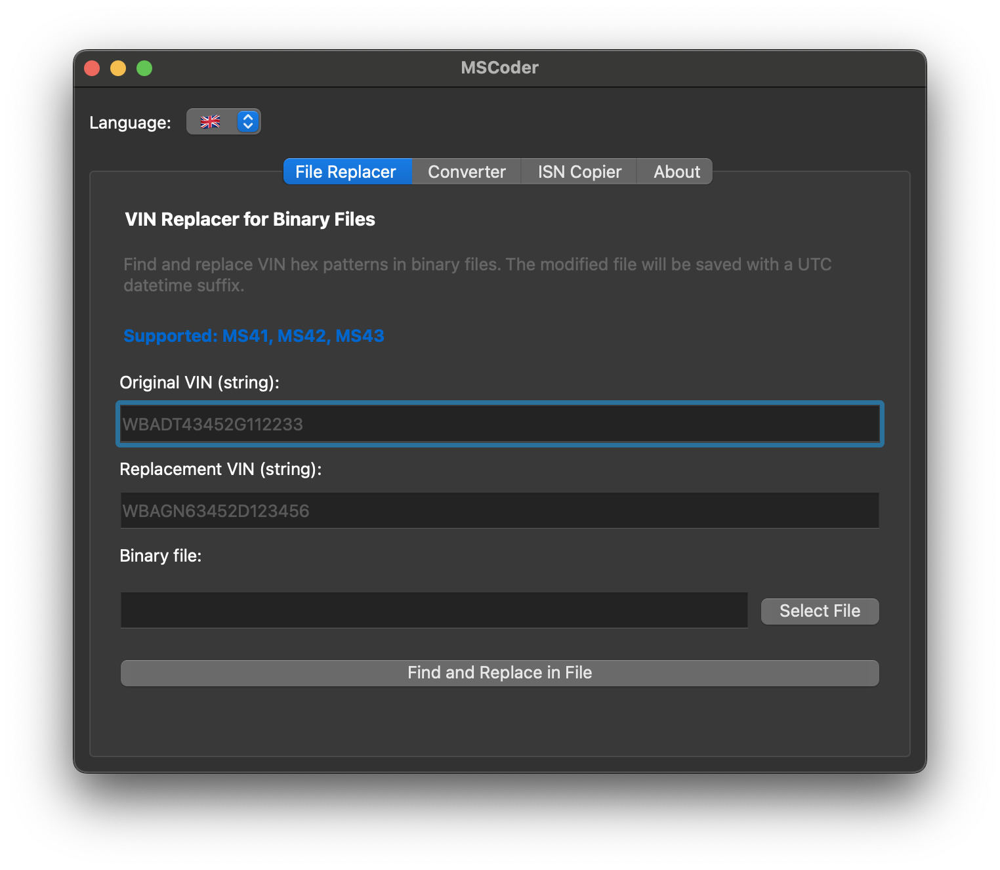
- **VIN Converter**: Convert between VIN string and hex bytes
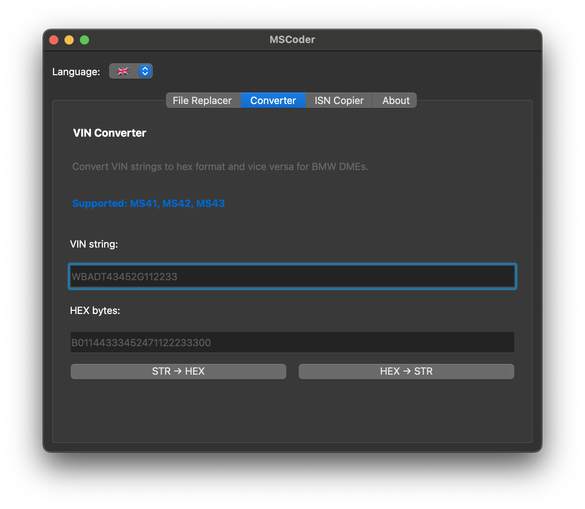
- **ISN Copier**: Copy ISN (Immobilizer Sequence Number) between MS42 and MS43 firmware files, with optional IMMO bypass functionality
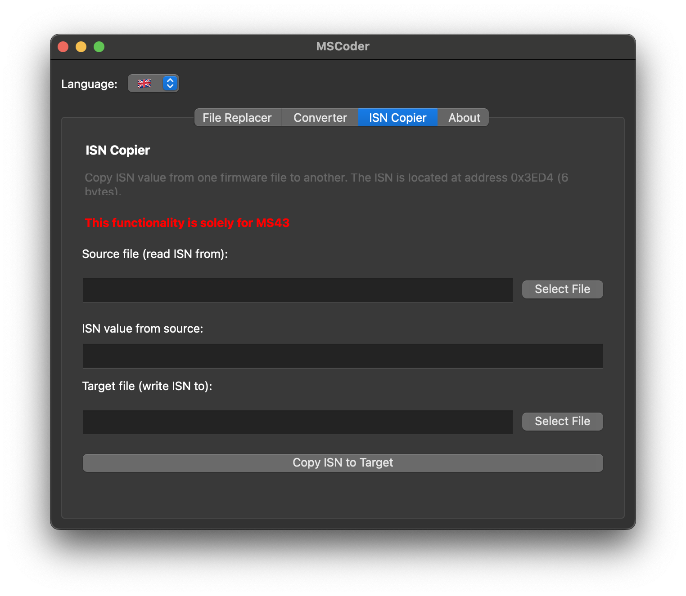

## Compatibility

### Supported Operations

- **VIN Editing**: MS41, MS42, MS43 DME binary files
- **ISN Copying with IMMO Bypass**: MS42, MS43 DME binary files

### Supported ECU Versions

IMMO bypass is supported for:
- **MS42** version 0110C6
- **MS43** version 430069

### File Requirements

**Only 512KB (MS42, MS43) or 256KB (MS41) firmware binary files should be used.**

### Flashing Requirements

**VIN + ISN flashing:**
- For MS42 and MS43: **Requires boot mode activation** (see [How to Connect](https://www.ms4x.net/index.php?title=How_to_connect))
- Does **NOT** require checksum correction in MS4X Flasher
- After flashing, VIN + ISN must be synced with EWS using INPA

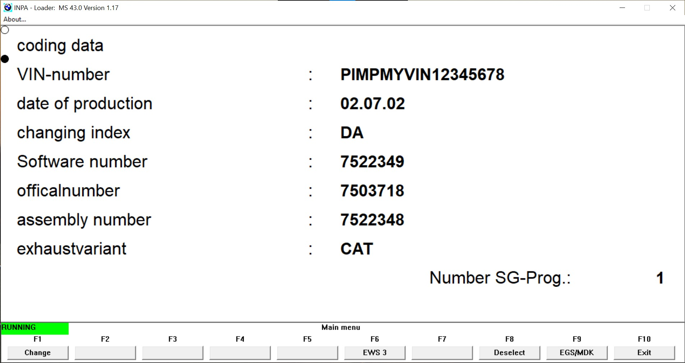

#### Example of sync for MS43:

Connect OBD2 cable, turn ignition to the 2nd position, and open INPA:
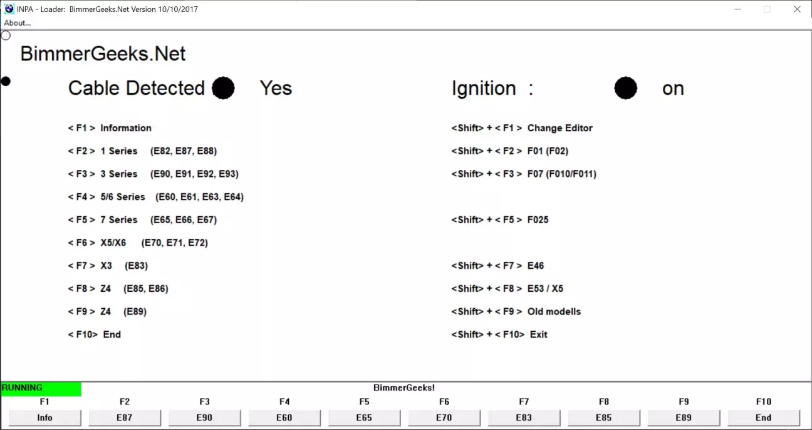

Press Shift + F7, then choose "Engine > MS 43.0 for M54"
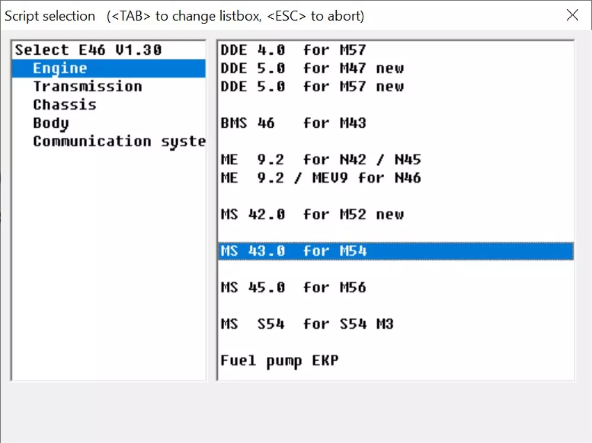

You'll see the main menu:
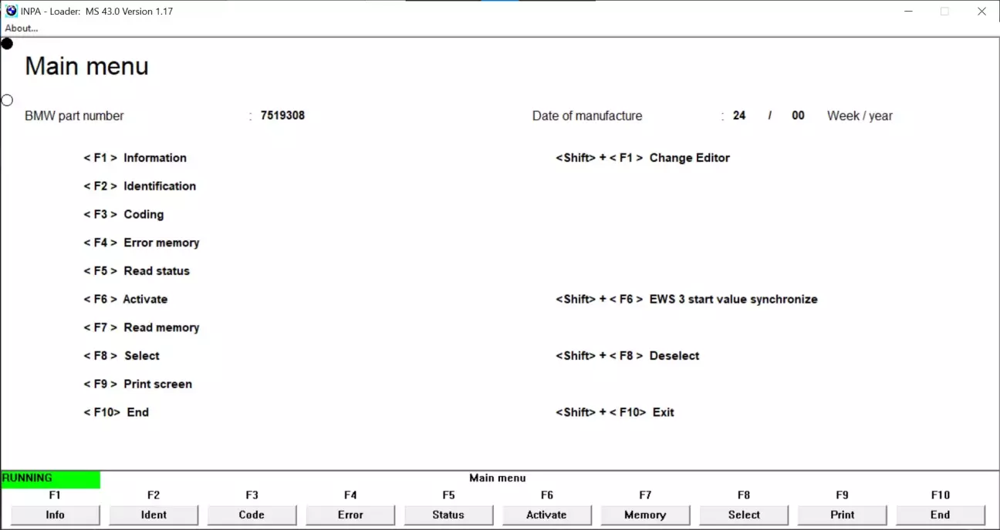

Press Shift + F6:
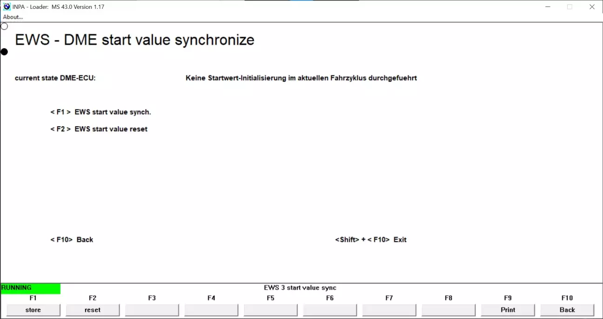

Press F2, then click Ok:
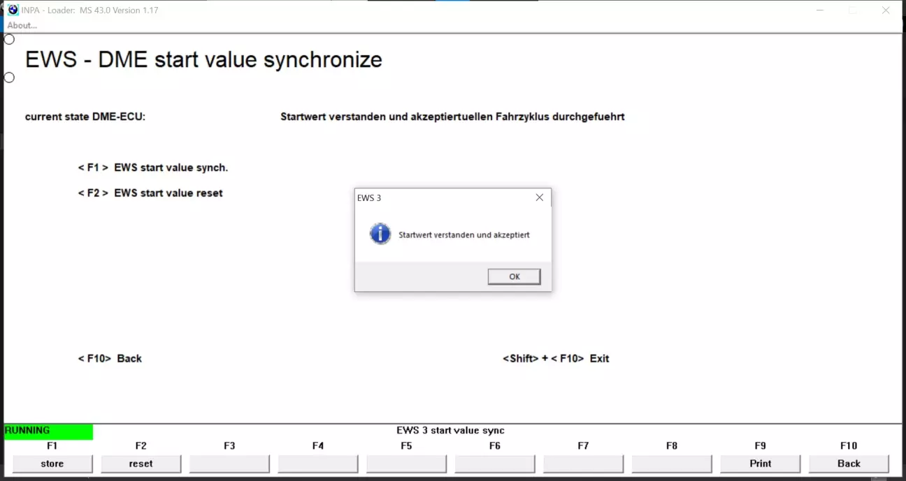

Press F1, then click Ok:
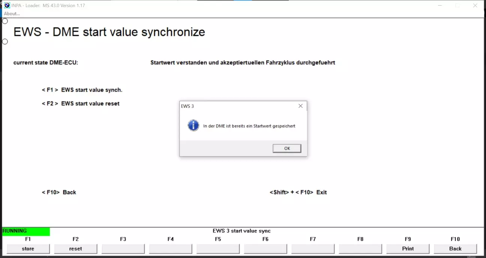

**IMMO bypass flashing:**
- Can be flashed **without boot mode** by [MS4X Flasher](https://www.ms4x.net/index.php?title=MS4x_Flasher)
- Allows the car to start without matching VIN + EWS ISN
- **⚠️ CRITICAL: Requires checksum correction in MS4X Flasher after using this feature. Car will not start without proper checksum correction!**

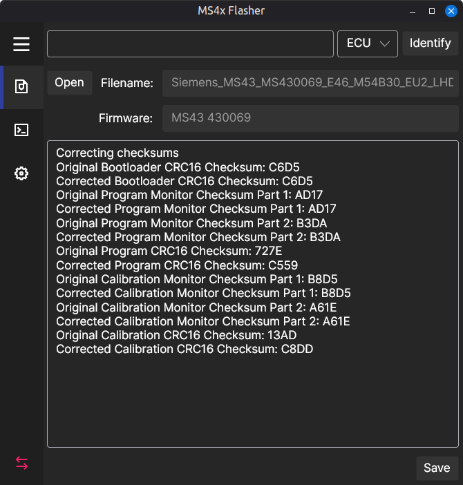

### Tested Configurations

This tool has been tested and proven to work on real hardware:
- **Platform**: BMW E46 with MS43 430069 on M54B30 engine
- **Tested combinations**:
  - VIN + ISN
  - VIN + ISN + bypass
  - ISN + bypass


## Installation

Download pre-built binaries for different distributions from the [Releases](https://github.com/sprytnyk/mscoder/releases) page.

Or run from source:

```bash
python3.11 -m pip install -r requirements.txt
python -m mscoder
```

## References

This project wouldn't exist without:

- [pyms41](https://github.com/OpenMS41/pyms41).
- [MS4X Community Patchlist](https://www.ms4x.net/index.php?title=TunerPro_MS43_Community_Patchlist)

And it was inspired by [E46 Temperature Gauge Hex Generator v1.0](https://www.e46fanatics.com/threads/diy-changing-temperature-gauge-buffer-range-with-pa-soft-1-4.1013600/)

## License

MIT License - see [LICENSE](LICENSE) file for details.
